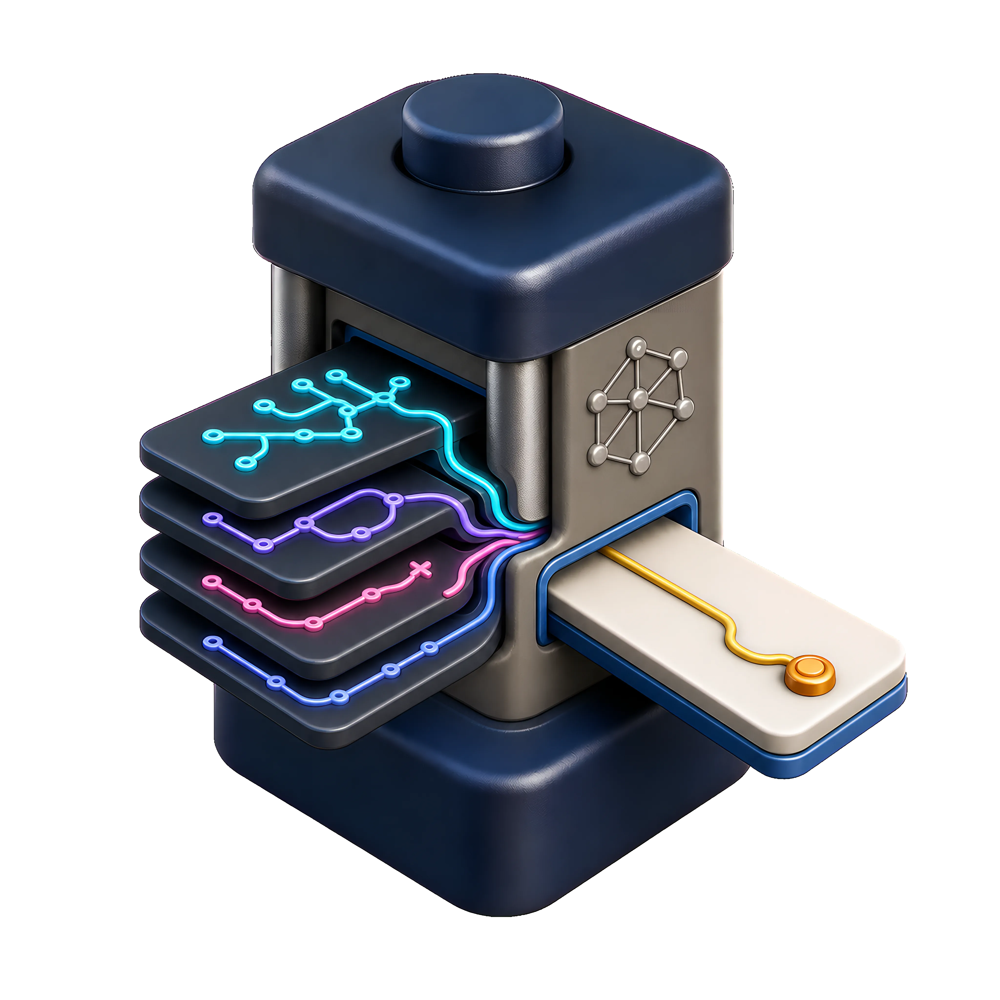
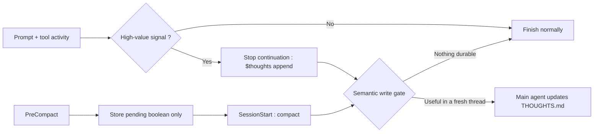

<div align="center">



# THOUGHTS

## Things Heard, Observed, Unclear, Guessed, Hacked, Tracked, or Suspected : A living document about non-trivial details

**Keep what context forgets**

[](https://github.com/EDM115/thoughts/actions/workflows/ci.yml)
[](https://skills.sh/EDM115/thoughts)
[](LICENSE)
[](https://agentskills.io/)

</div>

Long agent sessions produce valuable details that rarely belong in polished documentation yet : undocumented constraints, failed approaches, implementation tradeoffs, unresolved risks and the one strange fact that will save an hour tomorrow. Context compaction, a new thread, or a different agent can erase them.  
Saving every transcript is not the answer. It retains noise, may retain sensitive data and leaves the next agent to rediscover what mattered. `thoughts` maintains a deliberately selective `THOUGHTS.md` : a searchable scratchpad for non-obvious project knowledge that is not already authoritative elsewhere.  
The project has two layers :

- **Portable agent skill** : decides what deserves to be written, supports explicit maintenance commands and works in agent skills-compatible harnesses
- **Optional Codex plugin** : watches lifecycle signals and asks the main model to run the skill after high-value turns or after compaction. The hook never writes project thoughts itself

## What gets preserved

A candidate passes the write gate only when a capable agent starting a fresh thread would otherwise make a worse decision or repeat costly work. Good entries capture a durable constraint and why it matters :

```md
## 2026-07-22 — GPT-5.6 Sol Ultra — Codex — "Build selective project memory"

- `PreCompact` command hooks cannot invoke the model. Recovery must set a signal and inject `$thoughts append` through `SessionStart(source=compact)` after compaction.
```

Routine actions, status narration, simple answers and facts already present in README, AGENTS, plans, code, comments, tests, or issues stay out.  
`thoughts` preserves conclusions and useful reasoning artifacts, it does **not** request or store hidden chain-of-thought.

## Installation

### Standalone skill

Install the portable skill with the skills CLI :

```pwsh
npx skills add EDM115/thoughts
```

You can then invoke `$thoughts` explicitly. Harnesses that support implicit skill selection may also load it on high-value turns based on its description.

### Codex plugin

Add the marketplace and plugin to your Codex installation :

```pwsh
codex plugin marketplace add EDM115/thoughts
codex plugin add thoughts@edm115
```

Then open the Codex App -> Settings -> Hooks -> thoughts and click on Trust for each of the 6 hook types.  
The plugin hooks require Node.js 20 or newer. The standalone skill does not. Node.js from the bundled runtime should be sufficient.

## Commands

| Command             | Behavior                                                                                                        |
| ------------------- | --------------------------------------------------------------------------------------------------------------- |
| `$thoughts`         | Same as `append` : run the semantic write gate and write only if something qualifies                            |
| `$thoughts append`  | Read only the resolved `THOUGHTS.md`, use current context to add or refine the current agent's entry            |
| `$thoughts init`    | Scan the repository and create a useful initial scratchpad from verified, non-obvious facts                     |
| `$thoughts cleanup` | Rescan, remove obsolete agent facts, merge duplicates and compress wording while protecting user-authored notes |

Explicit invocation forces a check, not a mutation. A clean no-op is a valid result.

## File location and ownership

The skill resolves one canonical location :

1. Reuse the sole existing `THOUGHTS.md` at the repository root or established developer-documentation home
2. Stop if multiple candidates exist, never merge or choose silently
3. Otherwise use an established developer-documentation directory such as `docs/`, `documentation/`, or `developer-docs/`
4. Fall back to the repository root, never create `docs/` solely for this file

During ordinary work, only the main orchestrator edits the file. Exploration and review subagents never write it. A subagent owning substantial delegated work may return a concise `Thought candidates` section for the parent to vet.  
Agent entries are scoped by date, exposed model/reasoning level, harness and conversation. User entries use `YYYY-MM-DD — User — "Thought recap"`, ordinary append never edits them and cleanup reports substantial proposed rewrites instead of applying them automatically.  
Every new file starts with the exact template in [`skills/thoughts/assets/THOUGHTS.md`](skills/thoughts/assets/THOUGHTS.md).

## How the Codex lifecycle works



The hook uses deterministic signals to request a check when a prompt explicitly asks for thoughts persistence, large-scope work uses tools, two mutations occur, eight tool calls occur, delegation starts, or compaction recovery is pending. These thresholds do not force a write, the skill's semantic gate remains authoritative.

- **`Stop`** : returns a one-time continuation prompt that behaves like a new user prompt. `stop_hook_active` prevents a continuation loop.
- **`PreCompact`** : stores a pending boolean and allows compaction to continue. Command hooks cannot call the model here.
- **`SessionStart(source=compact)`** : injects developer context once after compaction, then clears the marker. A short unrelated prompt still produces no write.
- **`SubagentStart`** : tells subagents not to edit `THOUGHTS.md` and allows candidate reporting for substantial work.

The behavior follows OpenAI's current [Codex hooks contract](https://learn.chatgpt.com/docs/hooks).

## Privacy

Hook state lives under Codex's `PLUGIN_DATA` directory in a file named from a SHA-256 hash of the session ID. It contains only :

- turn ID
- explicit and large-scope booleans
- tool and mutation counts
- delegation and thoughts-touched booleans
- a compaction-pending boolean

Prompts, assistant messages, tool inputs and outputs, source paths, transcripts, source code and `THOUGHTS.md` contents are never persisted. Corrupt or unavailable state fails open so Codex can continue. Writes use a temporary sibling file followed by rename to avoid partial JSON.  
Plugin-bundled command hooks are executable code. Codex therefore requires users to review and trust the exact hook definition before it runs and changed hooks require review again.

## Limitations

- Implicit skill selection is model-controlled. Explicit `$thoughts` invocation is the portable reliable path, the Codex plugin adds lifecycle enforcement where hooks are supported.
- `PreCompact` cannot send a model prompt. It can only run deterministic code, stop compaction, or set state, this plugin deliberately recovers after compaction instead of blocking it.
- Mechanical thresholds are heuristics. They may request a semantic check after work that ultimately produces no entry.
- Tool hooks cover supported local function-tool paths, not every possible hosted or specialized tool.
- Conversation titles, model names and reasoning levels depend on what the harness exposes, the skill never invents missing metadata.
- Lifecycle automation is Codex-specific. The standalone skill remains usable elsewhere.

## Development

The hook, tests and validator use Node built-ins only and have no third-party runtime or development dependencies.

```pwsh
pnpm test
pnpm validate
```

CI runs both commands on Node.js 20 and 22. Tests cover classification, thresholds, trivial-turn skipping, thoughts-touch suppression, stop-loop prevention, compaction recovery, state corruption, privacy, subagent context, the command entrypoint and package structure.  
Focused bug reports and pull requests are welcome. Please keep new persistence behavior selective and include regression coverage.

## License

[MIT](LICENSE) © EDM115
